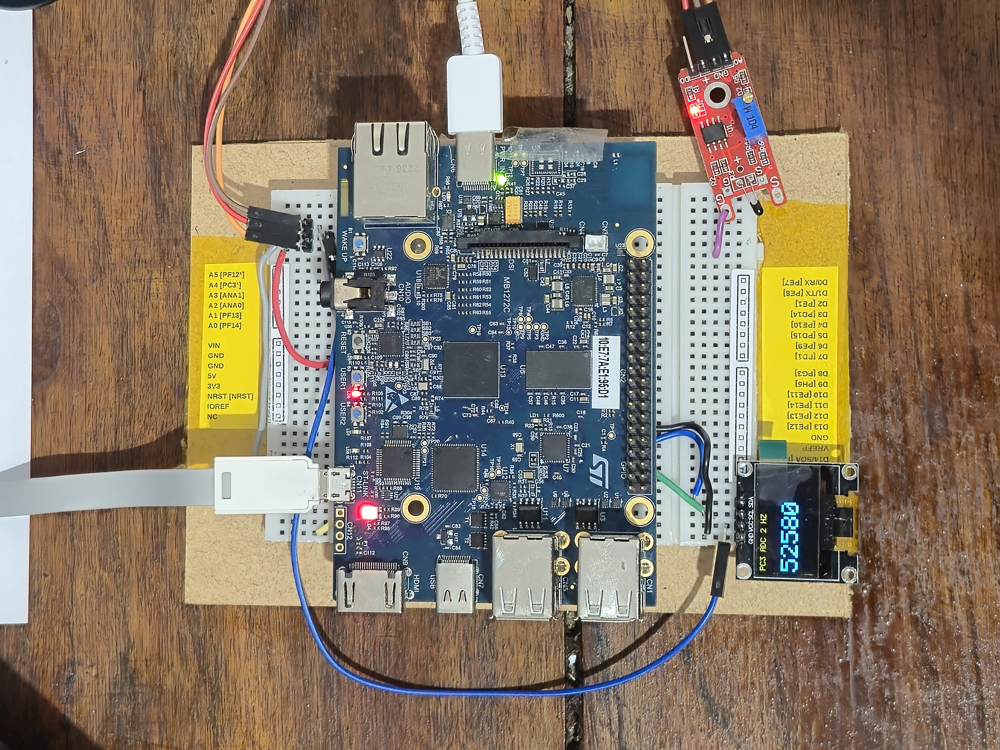
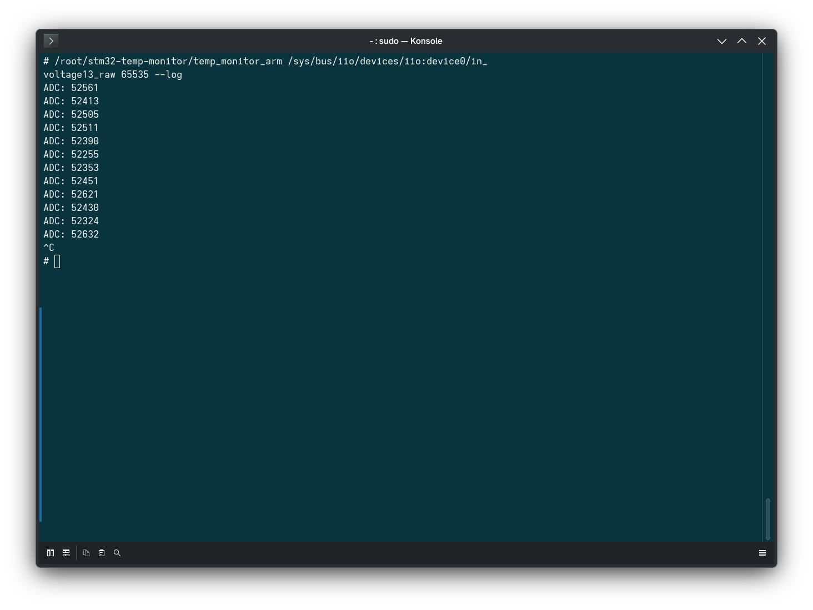
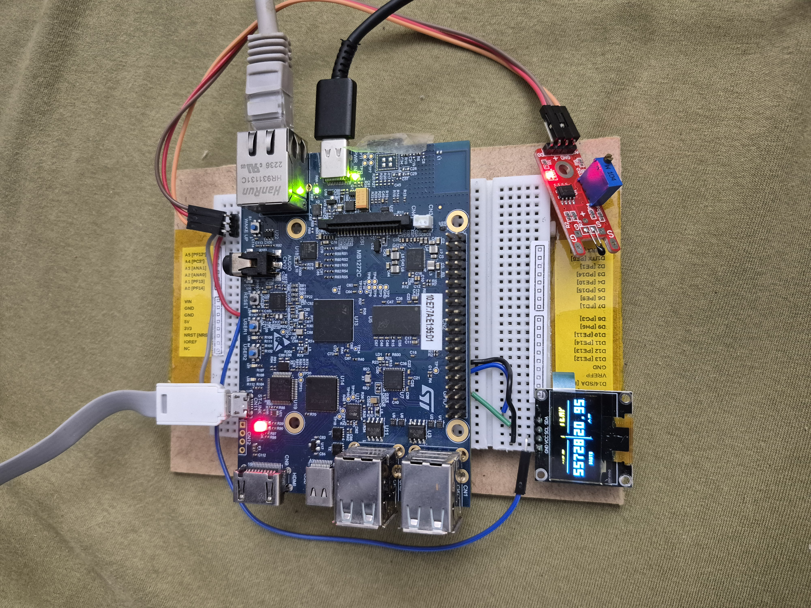
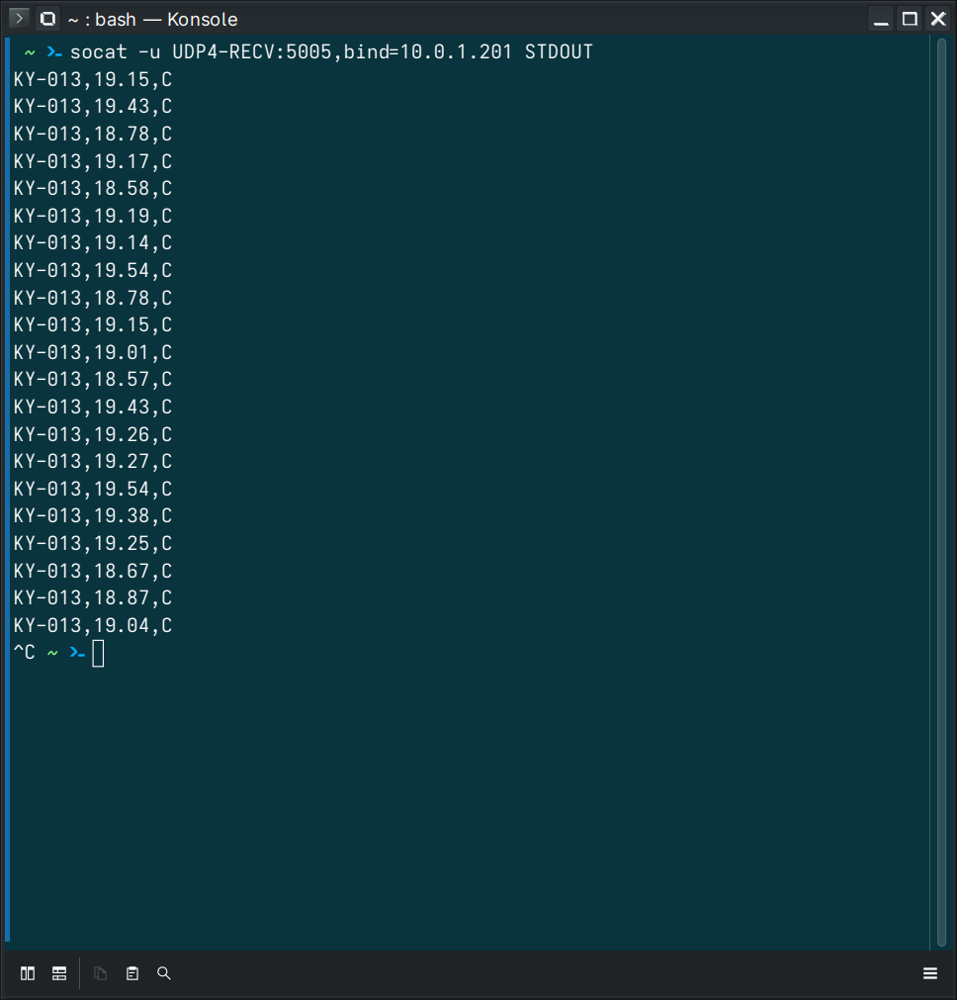

# STM32MP157 Temperature Monitor

**Integrantes:** Marcos Vinicius, Scarpini e Rios.

Sistema de monitoramento de temperatura em desenvolvimento, com sensor KY-013
e STM32MP1, utilizando C++ sobre Linux embarcado.

Atualmente, o programa adquire o ADC pelo subsistema IIO a 4 Hz e converte cada
amostra para temperatura em °C pelo modelo Beta do KY-013, com log opcional.
A Entrega 3 inclui conversão, envio UDP, testes e documentação. A execução
foi verificada na placa e os pacotes foram recebidos no PC. A comparação com
termômetro de referência em outros pontos permanece pendente; a interface
gráfica no PC pertence à Entrega 4.

## Hardware

| KY-013 | STM32MP157C-DK2 utilizada no teste |
| --- | --- |
| VCC | 3,3 V |
| GND | GND |
| Sinal (S) | PC3 — ADC1, canal 13 |

Faça as conexões com a placa desligada. O canal ADC deve estar habilitado no Linux.

## Compilação

Dependência: compilador C++ com suporte a C++14, como o `g++`.

```bash
g++ -std=c++14 -Wall -Wextra -pthread -Iinclude src/main.cpp src/TemperatureSensor.cpp src/UdpSender.cpp -o temp_monitor
```

## Uso

Informe o arquivo do canal IIO, o maior valor da escala do ADC e `--log`
para exibir cada leitura no terminal:

```bash
./temp_monitor /sys/bus/iio/devices/iio:device0/in_voltage13_raw 65535 --log
```

Ajuste o dispositivo, o canal e a escala conforme a configuração da placa.
Por exemplo, um ADC de 12 bits utiliza `4095`; um de 16 bits, `65535`.

```text
ADC: 55321 | Temperatura: 22.00 °C
ADC: 55300 | Temperatura: 22.05 °C
ADC: 55200 | Temperatura: 22.31 °C
```

A saída acima é ilustrativa, para escala de 16 bits e parâmetros padrão.

A primeira leitura ocorre imediatamente; as seguintes são programadas a cada
250 ms (4 Hz), usando relógio monotônico. O programa permanece em execução até
ser interrompido com **Ctrl+C** ou encontrar um erro. A frequência pode diminuir
se a aquisição ou a saída do terminal atrasar; não há rajadas para compensar atrasos.
O log apresenta o código bruto e a temperatura calculada da mesma amostra.

Sem `--log`, o programa continua lendo e convertendo a 4 Hz, mas não imprime as amostras:

```bash
./temp_monitor /sys/bus/iio/devices/iio:device0/in_voltage13_raw 65535
```

Falhas de aquisição ou conversão são informadas no terminal e encerram o programa
com código `1`. Argumentos ou configurações inválidos retornam código `2`.
Zero e fundo de escala continuam válidos em `readRaw()`, mas não permitem
conversão de temperatura e encerram a aplicação com erro.

### Parâmetros do KY-013 — Entrega 3

O padrão usa Beta = 3950 K, R₀ efetivo de 47338,20493605491 Ω e resistor fixo de 10 kΩ
e NTC entre sinal e GND, seguindo o exemplo atual da
[Joy-IT](https://sensorkit.joy-it.net/en/sensors/ky-013).
R₀ foi ajustado à referência fornecida pelo usuário: **ADC 55321 = 22 °C**,
na escala 65535. É um ajuste de um ponto, não uma medição da resistência
nominal do NTC. Beta e orientação permanecem hipóteses a validar.
A alimentação do divisor deve ser igual à referência do ADC (VCC = VREF).

```bash
./temp_monitor /sys/bus/iio/devices/iio:device0/in_voltage13_raw 65535 \
  --log --beta 3950 --r0 47338.20493605491 --series 10000 --ntc gnd
```

| Opção | Significado | Padrão |
| --- | --- | --- |
| `--beta` | Coeficiente Beta em kelvin | `3950` |
| `--r0` | R₀ efetivo a 25 °C, em ohms | `47338.20493605491` |
| `--series` | Resistência fixa do divisor, em ohms | `10000` |
| `--ntc` | NTC conectado entre sinal e `gnd` ou entre sinal e `vcc` | `gnd` |
| `--log` | Exibe ADC e temperatura no terminal | Desativado |

Consulte as [equações e hipóteses do modelo](docs/MODELO_KY013.md) e a
[validação da Entrega 3](docs/VALIDACAO_ENTREGA_3.md), incluindo o roteiro na placa.
Duas casas decimais no terminal não representam precisão metrológica de 0,01 °C.

## Estrutura

```text
include/TemperatureSensor.hpp      Interface da classe de leitura
src/TemperatureSensor.cpp          Aquisição IIO e conversão pelo modelo Beta
include/UdpSender.hpp              Interface de envio UDP
src/UdpSender.cpp                  Socket UDP e serialização CSV
tools/udp_receiver.py              Receptor de validação no PC
tools/S91tempudp                   Serviço de envio na placa
src/main.cpp                       Aplicação de linha de comando
tests/TemperatureSensorTests.cpp   Testes básicos de aquisição
Doxyfile                           Configuração do Doxygen
```

A classe `TemperatureSensor` recebe o caminho do canal e a escala do ADC.
O método `readRaw()` retorna uma amostra inteira entre zero e o máximo configurado.
`toCelsius(raw)` converte essa amostra sem acessar o ADC novamente.

## Compilação cruzada para a STM32MP157C-DK2

No computador Linux, utilize o SDK OpenSTLinux instalado em
`/home/marcos/sdk-stm32mp157`. Ele fornece o compilador C++, as bibliotecas do
alvo (sysroot) e as opções para o Cortex-A7. Execute os comandos de compilação
na raiz deste repositório.

### Carregar o ambiente do SDK

O seguinte alias está configurado no `~/.bashrc` do ambiente de desenvolvimento:

```bash
alias stm32cxx='source /home/marcos/sdk-stm32mp157/environment-setup-cortexa7t2hf-neon-vfpv4-ostl-linux-gnueabi'
```

Em um terminal Bash interativo, carregue a configuração e ative o SDK:

```bash
source ~/.bashrc
stm32cxx
```

Em scripts ou terminais sem esse alias, carregue diretamente o mesmo arquivo:

```bash
source /home/marcos/sdk-stm32mp157/environment-setup-cortexa7t2hf-neon-vfpv4-ostl-linux-gnueabi
```

Ative o SDK em cada novo terminal usado para compilação cruzada. Em outro
computador, ajuste o caminho para o local de instalação do SDK.

### Compilar e conferir o executável

```bash
$CXX $CPPFLAGS $CXXFLAGS -std=c++14 -Wall -Wextra -pthread -Iinclude \
  src/main.cpp src/TemperatureSensor.cpp src/UdpSender.cpp $LDFLAGS -o temp_monitor_arm
file temp_monitor_arm
```

Use `$CXX` sem aspas nesse comando: a variável contém o compilador e as opções
de arquitetura e sysroot definidas pelo SDK. As demais variáveis preservam as
opções de compilação e ligação fornecidas por ele.

O comando `file` deve identificar um executável **ELF de 32 bits para ARM**.
Execute esse binário na placa; para testes no computador, use a compilação
local com `g++` descrita acima.

### Transferir e executar no kit

Para transferência por rede, o computador precisa de `ssh` e `scp`, e a placa
deve estar acessível por SSH na mesma rede. No console da placa, consulte seu
endereço com `ip addr` ou `ifconfig`. No computador, ajuste o IP abaixo:

```bash
PLACA_IP=10.0.1.200
ssh root@"$PLACA_IP" 'mkdir -p /root/stm32-temp-monitor'
scp temp_monitor_arm root@"$PLACA_IP":/root/stm32-temp-monitor/
ssh root@"$PLACA_IP"
```

Já no terminal da placa, confira se o canal configurado está disponível e
execute o programa:

```bash
cat /sys/bus/iio/devices/iio:device0/in_voltage13_raw
cd /root/stm32-temp-monitor
chmod +x temp_monitor_arm
./temp_monitor_arm /sys/bus/iio/devices/iio:device0/in_voltage13_raw 65535 --log
```

O programa deve imprimir `ADC: <valor> | Temperatura: <valor> °C` a 4 Hz
até ser interrompido com Ctrl+C.
O caminho e a escala acima correspondem à configuração
PC3/ADC1_IN13 de 16 bits utilizada neste projeto. Se o arquivo não existir,
confira a [configuração do PC3](docs/PC3.md) antes de executar.

Antes da alteração para aquisição contínua a 4 Hz, a compilação com este SDK
OpenSTLinux e a execução do binário de leitura única foram
validadas em 02/11/2026 na STM32MP157C-DK2 com Buildroot 2025.02.1 e Linux 6.9.8.
O binário foi transferido por serial para `/tmp/entrega2_ostl_temp_monitor_arm`,
sem substituir o programa anterior, e seu SHA-256 foi conferido. As oito leituras
registradas retornaram código `0`, confirmando também a compatibilidade das
bibliotecas necessárias nessa imagem. Consulte o
[registro da validação com o SDK OpenSTLinux](docs/teste_adc_ostl.log).
O arquivo em `/tmp` é temporário e pode desaparecer ao reiniciar a placa.

## Visualização local no OLED

A nova implementação local em `tools/pc3_oled.cpp` mostra **o ADC bruto e a
temperatura em °C na mesma tela**, em duas colunas (ADC à esquerda e
temperatura à direita), atualizados a 2 Hz a partir da mesma amostra.
Ela usa a classe `TemperatureSensor` e os mesmos parâmetros do modelo Beta.
Falhas de conversão aparecem como `ERRO`, mantendo a leitura bruta visível.

O OLED SSD1306 de 128×64 pixels utiliza I²C: SDA em D14 (PA12), SCL em D15
(PA11), alimentação de 3,3 V e GND. Na configuração registrada, responde no
endereço `0x3C` de `/dev/i2c-1`. O PC3 permanece como entrada do sensor.

Consulte [compilação, prévia e instalação do OLED](docs/OLED.md).
A nova versão foi instalada em `/root/stm32-temp-monitor/pc3_oled_arm`
e o serviço `S90pc3oled` foi reiniciado e confirmado ativo em 09/11/2026.
O serviço preserva a descoberta automática do barramento I²C e o informa
com `--i2c`. Consulte o [registro da execução na placa](docs/teste_entrega3_placa.log).
A foto da tela em funcionamento está nas evidências da Entrega 3.

## Evidências da Entrega 2

Montagem da STM32MP157C-DK2 com o OLED exibindo o valor bruto do ADC do PC3.
O programa auxiliar do display atualiza a tela a 2 Hz.



Execução do `temp_monitor_arm` no terminal da placa com `--log`: aquisição
contínua a 4 Hz, exibição das leituras brutas e encerramento com Ctrl+C.



## Evidências da Entrega 3

Montagem do KY-013 na STM32MP157C-DK2 com o cabo Ethernet conectado. O OLED
apresenta o código bruto do ADC à esquerda e a temperatura calculada em °C à
direita. A foto registra uma leitura instantânea, sem comparação metrológica
com termômetro de referência.



Recepção no computador dos datagramas UDP enviados pela placa, usando `socat`
na porta 5005. As linhas mostram o protocolo `KY-013,<valor>,C` em execução.



## Testes

A validação da versão com temperatura está em
[VALIDACAO_ENTREGA_3.md](docs/VALIDACAO_ENTREGA_3.md). Os registros físicos
abaixo correspondem à versão da Entrega 2, que exibia apenas o ADC.

A versão contínua a 4 Hz foi compilada com o SDK OpenSTLinux e instalada em
`/root/stm32-temp-monitor/temp_monitor_arm` na STM32MP157C-DK2. O SHA-256 do
executável foi conferido após a transferência por serial. No teste com `--log`,
foram registradas 12 leituras em aproximadamente três segundos; o processo foi
encerrado intencionalmente com SIGTERM (código `143`). O serviço do OLED permaneceu
ativo. Consulte o [registro do teste a 4 Hz](docs/teste_adc_4hz.log).

Os testes usam um arquivo temporário para verificar a aquisição sem hardware:

```bash
g++ -std=c++14 -Wall -Wextra -Iinclude tests/TemperatureSensorTests.cpp src/TemperatureSensor.cpp -o temperature_sensor_tests
./temperature_sensor_tests
```

A aquisição física foi executada na STM32MP157C-DK2, usando PC3/ADC1_IN13
e resolução de 16 bits. O executável ARM leu oito amostras com código de saída `0`.
Consulte o [registro da leitura na placa](docs/teste_adc_pc3.log) e as
[instruções de configuração do PC3](docs/PC3.md).

O [registro de execução](docs/teste_adc.log) contém os comandos, as saídas e os
códigos de retorno de um teste local com entrada ADC simulada, incluindo a
compilação ARM. Os valores foram gravados em um arquivo temporário.

## Documentação

Dependência: Doxygen instalado no computador de desenvolvimento.

```bash
doxygen Doxyfile
```

A documentação da classe fica em `docs/doxygen/html/index.html`.

## Entrega 3: envio UDP

A placa (`10.0.1.200`) envia ao PC (`10.0.1.201`) pela ligação Ethernet.
No PC, inicie o receptor com `socat`:

```bash
socat -u UDP4-RECV:5005,bind=10.0.1.201 STDOUT
```

Como alternativa: `python3 tools/udp_receiver.py --bind 10.0.1.201 --port 5005`.

Na placa:

```bash
/root/stm32-temp-monitor/temp_monitor_arm \
  /sys/bus/iio/devices/iio:device0/in_voltage13_raw 65535 \
  --udp 10.0.1.201 5005 --log
```

O protocolo, os testes físicos e o serviço de inicialização estão em
[docs/UDP.md](docs/UDP.md).
